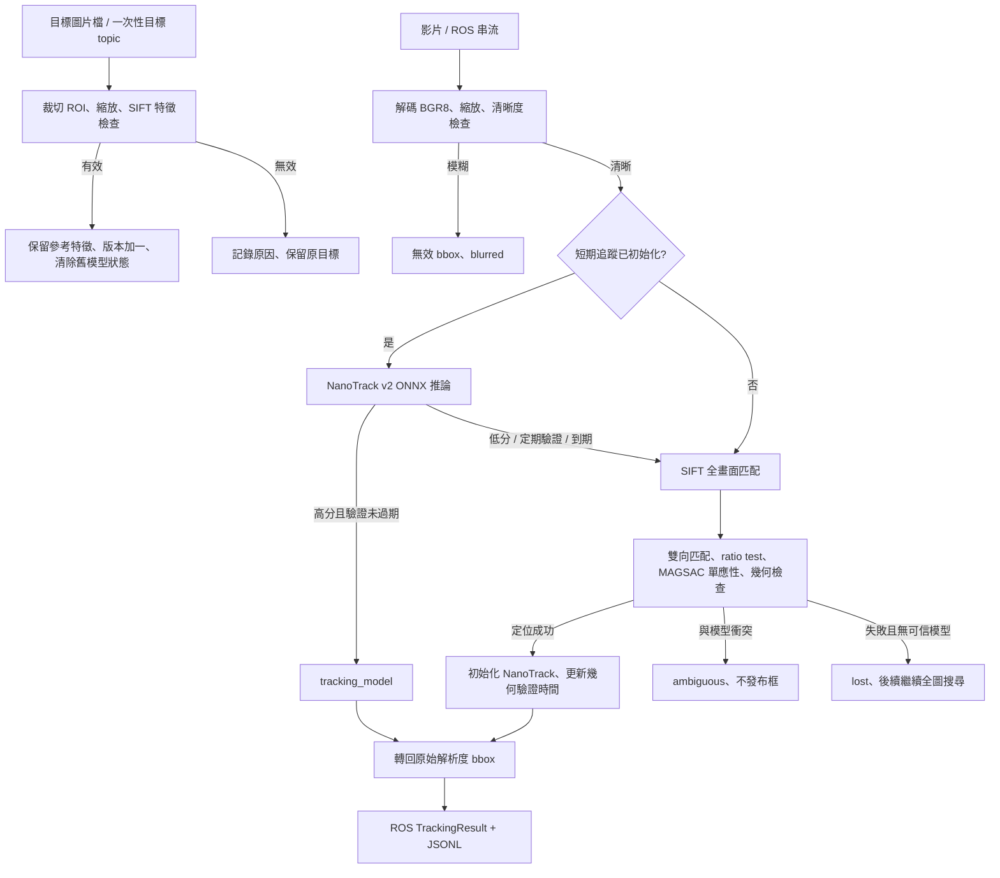

# Mobile Object Tracker — Rust / ROS 2

使用一張目標截圖，追蹤影片或 ROS 2 相機 topic 中的單一物件。採用 **NanoTrack v2 學習式追蹤 + SIFT/MAGSAC 全圖重新定位**。執行程式、模型推論、後處理、ROS adapter 與一次性目標發布工具均使用 Rust，無 Python 執行相依。

目標圖只需傳一次。程式保留它的特徵，直到新的有效目標圖到達；不需要每個影格重傳截圖。新圖驗證失敗時保留舊目標。程式不會自動理解截圖中的哪個物件才是目標：請提供緊貼物件的裁圖，或設定 `--target-roi` 排除背景。

> 這是可執行、可驗證的混合式追蹤起點，並非已對任意機器人場景保證的追蹤方案。NanoTrack 分數不是身分正確率。嚴重模糊、完全遮擋、相似物件和從未看過的背面仍可能失敗。已執行與尚未執行的驗證，請見 [驗證紀錄](docs/VALIDATION.md)。

## 1. 支援的組合

| 項目 | 輸入／輸出 | 說明 |
|---|---|---|
| 連續影像 | `--video demo.mp4` | 影片檔，依 FPS 節奏讀取，不跳過影格；推論較慢時播放也較慢 |
| 連續影像 | `--video camera:0` | OpenCV 攝影機 index |
| 連續影像 | `--video rtsp://...` | OpenCV backend 支援的 RTSP/HTTP；編碼支援取決於本機 FFmpeg/GStreamer |
| 連續影像 | `--image-topic /camera/image_raw` | ROS 2 `sensor_msgs/msg/Image` |
| 連續影像 | 加 `--image-compressed` | topic 改用 `sensor_msgs/msg/CompressedImage` |
| 目標參考 | `--target object.jpg` | 啟動時載入並保留 |
| 目標參考 | `--target-topic /tracker/target_image` | 每收到一張有效圖，替換目標並重新定位 |
| 目標參考 | 加 `--target-compressed` | topic 改用 `sensor_msgs/msg/CompressedImage` |
| 主要輸出 | `/tracker/bbox` | 自訂 `mobile_tracker_interfaces/msg/TrackingResult`，含 bbox、header、有效旗標、目標版本與狀態 |
| 文字輸出 | stdout、`--jsonl results.jsonl` | 一行一個 JSON；診斷訊息只寫 stderr |

影片／ROS 串流 × 圖片／ROS 截圖四種組合均支援。`--target` 和 `--target-topic` 可以同時指定：先用檔案初始化，之後接收新的目標。連續影像來源二選一。

單純影片模式不需要安裝 ROS。影片輸入也能加 `--ros` 發布 ROS bbox。程式無 GUI，不需要桌面環境。

## 2. 系統與安裝

設計支援以下 ROS 2 平台；這不表示已在兩者完成實機測試，實際驗證範圍見驗證紀錄。

| 平台 | ROS 版本 |
|---|---|
| Ubuntu 22.04 | Humble |
| Ubuntu 24.04 | Jazzy |

使用 Rust stable（1.89 以上；以 `Cargo.lock` 固定 Rust 相依）、OpenCV 4.5.4 以上、libclang 和 C++ 編譯工具。學習式模型使用 OpenCV DNN 的 CPU backend，不要求 CUDA，也不使用 OpenCV `TrackerNano` API，因此不要求新版 tracking 模組。SIFT 與 MAGSAC 由 OpenCV 提供。

### 2.1 安裝原生相依

```bash
sudo apt update
sudo apt install -y build-essential cmake pkg-config clang libclang-dev \
  libopencv-dev curl git
# 若尚未安裝 Rust，依 https://rustup.rs 安裝 stable toolchain
rustc --version
cargo --version
pkg-config --modversion opencv4
```

### 2.2 下載與驗證模型

```bash
git clone https://github.com/noName-ll/object-tracking.git
cd object-tracking
bash scripts/download_models.sh
```

模型不放進 Git，下載腳本會檢查 SHA-256，已存在且校驗正確時不重下載。來源為 HonglinChu/SiamTrackers 的 NanoTrack v2，不可任意替換成 v1/v3 或其他匯出格式。

| 檔案 | SHA-256 |
|---|---|
| `models/nanotrack_backbone_sim.onnx` | `530bdd0cd00f19afab79a863e71ba71e3312395a5dc9151af675082bdaaa2fc4` |
| `models/nanotrack_head_sim.onnx` | `0d8c0637be849f092cc7236cae02e55c8b9455ebe37ba50601d6115db4247cd9` |

模型／演算法來源與授權見 [THIRD_PARTY.md](THIRD_PARTY.md)。

### 2.3 不使用 ROS 的編譯

```bash
cargo build --release --locked
./target/release/mobile-object-tracker --help
```

### 2.4 ROS 2 編譯

先安裝 ROS 2 Humble 或 Jazzy，再開一個乾淨終端；不要同時 source 不同發行版。

```bash
# Humble；Jazzy 改成 /opt/ros/jazzy/setup.bash
source /opt/ros/humble/setup.bash
sudo apt install -y python3-colcon-common-extensions \
  ros-${ROS_DISTRO}-rosidl-default-generators \
  ros-${ROS_DISTRO}-sensor-msgs ros-${ROS_DISTRO}-std-msgs
bash scripts/build_ros2.sh
```

`python3-colcon-common-extensions` 是 ROS 的建置工具，不是追蹤程式的執行相依。腳本先以 colcon 建置訊息，再 source 訊息 overlay，最後用 Cargo 建置 Rust 執行檔。Rust 執行檔不透過 `ros2 run` 啟動，直接執行即可。

手動步驟等同：

```bash
colcon build --base-paths ros2 --build-base build/interfaces \
  --install-base install/interfaces --packages-select mobile_tracker_interfaces
source install/interfaces/setup.bash
export IDL_PACKAGE_FILTER='builtin_interfaces;std_msgs;sensor_msgs;geometry_msgs;unique_identifier_msgs;action_msgs;mobile_tracker_interfaces'
cargo build --release --locked --features ros2
```

`r2r` 會根據已 source 的 ROS 安裝生成 binding。自訂訊息必須在 Rust 編譯前可見；新增／變更 `.msg` 或切換 ROS 發行版後，重新建置 interfaces，再執行 `cargo clean` 和完整編譯。不要用 `--all-features` 建立正式執行檔：`ros2-doc` 只是無 ROS 環境中的型別檢查功能，無法連結成可用的 ROS node。

每個執行終端都要：

```bash
source /opt/ros/humble/setup.bash  # 或 jazzy
source install/interfaces/setup.bash
# 若其他 node 使用非預設 domain，請設定相同的值
export ROS_DOMAIN_ID=0
```

## 3. 執行範例

### A. 影片 + 圖片，不使用 ROS

```bash
./target/release/mobile-object-tracker \
  --video demo.mp4 --target object.jpg \
  --target-roi 120,80,240,300 --jsonl results.jsonl
```

ROI 是目標截圖原始解析度中的 `x,y,width,height`，不是影片中的位置。已裁好的物件圖可省略 ROI。未指定時整張圖都會建立特徵；背景多時容易匹配到背景。

### B. ROS 相機 + 圖片，輸出 ROS bbox

```bash
./target/release/mobile-object-tracker \
  --image-topic /camera/color/image_raw \
  --target object.jpg --bbox-topic /tracker/bbox
```

### C. ROS 相機 + 一次性 ROS 目標截圖

先啟動追蹤器：

```bash
./target/release/mobile-object-tracker \
  --image-topic /camera/color/image_raw \
  --target-topic /tracker/target_image
```

再從另一個已 source ROS 和 overlay 的終端送一次目標圖：

```bash
./target/release/send-target --file cropped_object.jpg
```

`send-target` 會先等相容 subscriber 出現，最多 10 秒；發送一張 BGR8 圖片後，再保持 publisher 存活 2 秒。它不會循環發送圖片。追蹤器接收成功後會保留目標，即使發布工具結束也可繼續追蹤。

換追蹤物時再執行一次：

```bash
./target/release/send-target --file another_object.jpg
```

每張成功接收的有效目標圖都視為新的目標事件，即使內容相同也會增加版本。尚未收到目標時，對每張串流畫面輸出 `waiting_target`。無效目標圖會被拒絕並記錄 stderr，原目標與版本保持不變。

如果要讓追蹤器在發布後才啟動，也能收到那張圖：發布端與訂閱端都設定 transient local，且**發布端必須保持存活**：

```bash
# 追蹤器
./target/release/mobile-object-tracker \
  --image-topic /camera/color/image_raw \
  --target-topic /tracker/target_image --target-durability transient-local

# 發布一次後長時間保持 publisher 存活；等待 subscriber 的時間也可調長
./target/release/send-target --file cropped_object.jpg \
  --transient-local --wait-seconds 60 --keep-alive-seconds 3600
```

Transient local 不會在 publisher 結束後替你永久保存資料。預設 volatile 模式，請先啟動追蹤器再送截圖。這兩種模式的差別是 DDS 是否提供晚加入者歷史資料；都不影響追蹤器收到後在記憶體中保留目標。程式重啟後，記憶體中的目標會消失。

### D. 影片 + ROS 目標截圖，輸出 ROS bbox

```bash
./target/release/mobile-object-tracker \
  --video demo.mp4 --target-topic /tracker/target_image
./target/release/send-target --file cropped_object.jpg
```

### E. 影片 + 圖片，也發布 ROS bbox

```bash
./target/release/mobile-object-tracker \
  --video demo.mp4 --target object.jpg --ros
```

### F. 壓縮 topic

```bash
./target/release/mobile-object-tracker \
  --image-topic /camera/image/compressed --image-compressed \
  --target-topic /tracker/target/compressed --target-compressed
```

這裡直接訂閱 `CompressedImage`，不是 `image_transport` 外掛。ROS topic 型別必須與選項一致；本專案的 `send-target` 只發原始 `Image`。

## 4. ROS 輸入規格與 QoS

### 連續影像 topic

- 預設型別 `sensor_msgs/msg/Image`，支援 `bgr8`、`rgb8`、`mono8`、`bgra8`、`rgba8`。
- 正確處理 `step` 的每行 padding；8-bit 資料不需要位元組序交換。
- 不接受 `16UC1` 深度圖、YUV、Bayer、浮點影像；請在上游轉成支援的色彩影像。
- 選用壓縮輸入時，JPEG／PNG 等格式由 OpenCV decoder 決定；不是深度壓縮格式 `compressedDepth`。
- 使用 best-effort、volatile、keep-last depth=1，能連接常見的 sensor-data publisher。
- 每次 polling 取已交付訊息中的最新圖，避免為已過時的影像排長隊；這不是全系統零延遲保證。
- 原始圖轉換有 256 MiB 上限，壓縮資料有 64 MiB 上限。

### 目標參考 topic

- 型別和影像編碼與連續影像相同，獨立指定是否為 compressed。
- reliable、keep-last depth=1；durability 預設 volatile，可切換 transient-local。
- 上游也應使用 reliable。best-effort publisher 與此 reliable subscriber 不相容。
- 每張圖片作為替換事件。若短時間送很多張，只採用已交付佇列中最後一張，不保證處理每個中間目標。
- `--target-roi` 若有指定，會套用於檔案和每張 ROS 目標圖；各截圖尺寸不同時，建議先裁成物件圖並省略 ROI。
- 截圖的 header 不用來同步串流；輸出 header 來自被處理的串流畫面。跨來源截圖只作外觀參考。

### 輸出 topic

`--bbox-topic` 預設 `/tracker/bbox`，reliable、volatile、keep-last depth=1。每張已處理的畫面發布一次，另外在目標切換、來源逾時、影片結束時發布無效結果。輸出型別是自訂訊息，**不是** `vision_msgs/Detection2DArray` 或字串包 JSON。

```bash
ros2 interface show mobile_tracker_interfaces/msg/TrackingResult
ros2 topic echo /tracker/bbox
ros2 topic info /tracker/bbox --verbose
```

## 5. Bounding box 與結果格式

座標一律是**原始串流解析度的像素座標**，不是縮小推論圖，也不是目標截圖的座標。原點在左上角，x 向右、y 向下。使用軸對齊 bbox；傾斜物件投影的外接矩形可能包含背景。

| 欄位 | 型別 | 意義 |
|---|---|---|
| `header` | `std_msgs/Header` | ROS 輸入完整保留串流來源的 stamp/frame_id；影片則使用讀取完成的系統 UTC 時間與 `--frame-id` |
| `sequence` | uint64 | 已處理／拒絕的來源影格序號；事件訊息可能重用上一個序號 |
| `target_generation` | uint64 | 成功替換目標的版本，從 1 開始，還沒收到目標為 0 |
| `status` | string | 見下表 |
| `found` | bool | ROS 欄位，是否有目前可用的 bbox |
| `x,y,width,height` | float32 | ROS bbox；已裁切至畫面範圍；`found=false` 時全部為 0 |
| `image_width,image_height` | uint32 | 原始串流影像尺寸 |
| `model_score` | float32 | NanoTrack 選定候選的原始前景 softmax，未經身分機率校準；純幾何定位時為 0 |
| `inliers,inlier_ratio` | uint32/float32 | 本筆成功幾何定位的內點數／比例；沒有成功幾何驗證時為 0 |
| `blur_variance` | float64 | 縮小串流灰階圖的拉普拉斯變異數，不是通用清晰度機率 |
| `processing_ms` | float64 | resize、匹配、推論等處理時間，不含串流擷取、DDS、發布與落盤 |
| `has_source_position` | bool | ROS 欄位，是否有影片位置 |
| `source_position_ms` | float64 | 影片 backend 回報的媒體位置；ROS／live stream 沒有此位置 |

JSONL 以 `bbox: {x,y,width,height}` 或 `bbox: null` 表示有效性，而不是 ROS 的四個展平欄位。沒有影片位置時 `source_position_ms:null`。例：

```json
{"header":{"stamp":{"sec":123,"nanosec":456},"frame_id":"camera_optical_frame"},"sequence":42,"source_position_ms":null,"target_generation":2,"status":"tracking_model","bbox":{"x":120.0,"y":80.0,"width":100.0,"height":150.0},"image_width":1280,"image_height":720,"model_score":0.91,"inliers":0,"inlier_ratio":0.0,"blur_variance":132.5,"processing_ms":18.0}
```

### 狀態

| status | 是否有 bbox | 含義 |
|---|---|---|
| `waiting_target` | 否 | 沒有有效參考圖 |
| `target_changed` | 否 | ROS 收到新有效目標，立即清掉舊追蹤狀態 |
| `tracking_verified` | 是 | 本幀通過 SIFT/MAGSAC 幾何驗證，初始化／重新初始化 NanoTrack |
| `tracking_model` | 是 | 本幀由 NanoTrack 追蹤，仍在最近幾何驗證的有效時間內 |
| `lost` | 否 | 模型／幾何條件不足，或幾何驗證過期 |
| `blurred` | 否 | 低於模糊閾值，不發布猜測框並清除短期追蹤 |
| `ambiguous` | 否 | 模型框與特徵框 IoU < 0.1；拒絕直接跳到另一個候選 |
| `invalid_frame` | 否 | ROS 影像解碼／格式驗證失敗 |
| `source_timeout` | 否 | ROS 串流在指定時間內沒有交付新影像；之後持續發無效心跳 |
| `source_ended` | 否 | 影片 EOF／live backend 讀取失敗，ROS 模式最後發布一次後結束 |

無效事件的 header 保留最近相關來源畫面的 header，不能把事件發布時間解讀為新的相機曝光時間。`source_timeout` 前從未收到畫面時 header 為 0、尺寸為 0。

下游應同時檢查 `found`、`status`、`target_generation` 與影像時間戳是否新鮮；不要在 `found=false` 時保留上一個框，也不要把 bbox 直接當成三維距離。若要結合深度圖，需以相機 stamp/frame_id 做時間與座標對齊。

## 6. 演算法與資料流程



### 6.1 初次定位／重新搜尋

1. 目標截圖套用使用者 ROI，長邊中的寬度上限為 `min(max-width,640)`；串流寬度最多 `max-width`。只在寬度超標時等比例縮小。
2. 提取 SIFT 關鍵點和浮點描述子。參考圖至少要有 `min-inliers` 個特徵，否則不接受。
3. BFMatcher L2 找兩個最近鄰；Lowe ratio `<0.75`，再要求反向最近鄰一致。
4. 用 USAC_MAGSAC 估計參考圖到串流圖的單應性；重投影門檻 4 個推論影像像素，最多 5000 次，confidence=0.999。
5. 要求內點數至少 `min-inliers`、內點比例至少 `min-ratio`，參考內點凸包覆蓋至少 3.5% 的參考圖面積。
6. 投影參考圖四角，要求有限數值、凸四邊形、面積至少 100 推論像素²且不超過畫面 1.5 倍、至少 35% 投影面積可見。
7. 取投影的軸對齊外接 bbox，裁至畫面內，再於當前畫面初始化 NanoTrack。

全圖搜尋用於初次定位、模型低分、定期驗證與幾何驗證到期。它不假設相機背景固定，但如果參考圖帶有大量背景，仍可能對背景建立有效單應性，所以裁圖很重要。

### 6.2 學習式連續追蹤

NanoTrack 是單目標 Siamese 追蹤網路，不是語意偵測器：它比較模板與搜尋區域，預測目標位置，無需先知道物件類別。

- 模板：目標周圍含 context 的正方形 crop，resize 至 127×127。
- 搜尋：以上一個框中心為中心，context 搜尋區 resize 至 255×255。
- 色彩：BGR 轉 RGB，float32，值域 0–255，scale=1，不做 ImageNet mean/std。
- Backbone ONNX 分別取得模板／搜尋特徵；head 的輸入名稱為 `input1`、`input2`。
- Head 輸出 `output1: [1,2,16,16]` 前景／背景 logits，以及 `output2: [1,4,16,16]` 的 left/top/right/bottom 距離。
- Rust 對分類做 softmax，搭配尺度、長寬比懲罰與 Hann window 選候選；stride=16、penalty=0.055、window influence=0.455、尺寸更新率基數=0.37。
- 以選定候選的**原始前景 softmax**做 `model-score` 閘門，不用混合 Hann window 後的分數假裝模型信心。
- 低分、非法數值或非法 bbox 不寫回追蹤狀態。參考截圖特徵不會被模型結果自動覆寫。

模型能利用連續畫面處理有限的姿態、外觀與尺度變化，但搜尋區是局部的；底盤突然大幅轉動可能把物件移出搜尋區，需要全圖重新定位。

### 6.3 混合驗證與防漂移

每 `verify-every` 個已處理影格做幾何驗證；模型失敗時同幀就執行全圖定位。模型與特徵候選 IoU < 0.1 時輸出 `ambiguous`，先清掉短期狀態，下一幀重新搜尋。

若定期 SIFT 失敗，但 NanoTrack 分數足夠，最多允許在上次幾何驗證後 `verification-ttl-ms` 的時間內繼續模型追蹤。逾時則 `lost`。這是避免模型無限制漂移的策略，也意味著轉到沒有參考特徵的背面超過此時間，會主動放棄。時間限制依處理程序的單調時鐘，不是影片媒體時間。

SIFT 幾何成功也不能保證是原本那個實體，兩個外觀相同的盒子仍可能混淆。本版不含多目標身分管理、ReID、多視角圖庫、自動前景分割或里程計補償。

### 6.4 模糊、丟失與目標切換

在縮小後全畫面上量測 Laplacian variance。低於閾值時輸出 `blurred` 並清掉短期模型，不使用舊框或運動預測當成觀測。低紋理畫面也可能被判為模糊，請依實際相機調整；可用 `--blur-threshold 0` 停用此閘門。

本版沒有去模糊網路、Kalman 預測或相機運動補償。模糊最好先以縮短曝光、補光、降低速度處理。恢復清晰後重新全圖搜尋；若此時物件已轉到參考圖沒有的表面，可能無法重新找到。

新參考圖先完成解碼、ROI 與特徵檢查，成功後才原子替換，`target_generation` 加一，清除模型與幾何驗證時間；下一張串流影像重新全圖定位。沒有新截圖時不做目標替換。

## 7. 調整參數

| 參數 | 預設 | 用途／取捨 |
|---|---|---|
| `--max-width` | 960 | 串流推論寬度上限；提高可保留遠方細節但變慢 |
| `--min-inliers` | 12 | 幾何內點數下限，越高越嚴格 |
| `--min-ratio` | 0.4 | 幾何內點比例下限 |
| `--model-score` | 0.75 | 模型原始前景分數門檻，需用實際影片校準 |
| `--blur-threshold` | 25 | 全畫面 Laplacian variance 門檻，0 停用 |
| `--verify-every` | 15 | 定期全圖驗證的處理影格間隔 |
| `--verification-ttl-ms` | 5000 | 未再次通過幾何驗證可繼續模型追蹤的最大牆鐘時間 |
| `--gap-timeout-ms` | 1200 | 兩次處理相隔太久時丟棄短期位置，重新全圖定位 |
| `--source-timeout-ms` | 1000 | ROS source silence 的無效心跳間隔／門檻 |
| `--frame-id` | camera | 只套用影片；ROS 影像保留原 frame_id |
| `--backbone`, `--head` | models/… | 模型路徑，相對目前工作目錄 |

不要只降低所有門檻來讓框一直存在。建議用正樣本、無目標畫面、相似物件、底盤轉彎、遮擋與模糊影片，一起量測誤追率、丟失率、重定位時間與端到端延遲。

## 8. 執行限制與部署注意

- 本版單一目標、單一 process；無目標圖持久化。重啟時使用檔案參考或再發一次 topic。
- ROS subscription spin、參考替換與追蹤依序進行；推論期間不會平行替換目標。DDS depth=1 減少排隊，但不能保證每個短暫事件都被處理。
- RTSP／攝影機擷取使用同步 OpenCV API；backend 阻塞時可能延遲 ROS polling 和 Ctrl-C，未實作獨立擷取執行緒、自動重連或硬性 read deadline。低延遲部署優先用已在上游正常發布的 ROS image topic。
- ROS 來源逾時用「本程式沒有收到畫面」判斷；仍持續送舊 stamp 的 publisher 不會觸發此逾時，下游必須檢查 stamp 新鮮度。
- 影片 header 是系統接收時間，不是相機曝光／ROS 模擬時間；媒體位置另記 `source_position_ms`。不支援 `use_sim_time` 的影片時鐘。
- 裁框沒有物件語意分割，特徵多的背景仍可能主導匹配。
- 單應性最適合可見的平面表面。物件大幅三維旋轉後，幾何重新定位可能失敗。
- 模型只用 CPU；未承諾 FPS，需在你的硬體與解析度量測。
- 不輸出三維位置、距離、姿態，也不控制底盤或機械手臂。

## 9. 測試與原始碼

```bash
cargo fmt --check
cargo test --locked --no-default-features        # 純 Rust 契約／像素資料測試
cargo test --locked                              # 含原生 OpenCV
# 下載模型後，執行真正 ONNX 推論與合成場景測試
cargo test --locked --test hybrid -- --ignored --nocapture
# 已 source ROS 與自訂訊息 overlay 時
cargo check --locked --features ros2
# 真正的 ROS graph 測試：一次性目標、更換目標、bbox、header、source timeout
# 只能在已 source ROS/overlay 且可用 DDS 的環境執行
cargo test --locked --features ros2 --test ros_transport -- --ignored --nocapture
```

ROS 無法安裝的開發環境可用 `cargo check --locked --features ros2-doc` 做 Rust API 型別檢查；這不代表 ROS graph、DDS QoS 或自訂訊息生成已通過執行測試，也不能用這個 feature 建置部署程式。

| 路徑 | 職責 |
|---|---|
| `src/nano.rs` | ONNX 推論、搜尋區裁切、NanoTrack 後處理 |
| `src/tracker.rs` | 參考保留、SIFT/MAGSAC、混合追蹤狀態機 |
| `src/ros.rs` | ROS 2 image subscriptions、自訂 bbox publisher、source timeout |
| `src/pixels.rs` | ROS raw buffer 編碼、行距與資料長度檢查 |
| `src/contract.rs` | bbox、header、JSON／ROS 契約、目標版本槽 |
| `src/video.rs` | 影片／攝影機擷取與檔案節奏 |
| `src/cli.rs` | CLI、選項驗證 |
| `src/bin/send_target.rs` | 一次性發布目標圖的 Rust 工具 |
| `ros2/mobile_tracker_interfaces/` | ROS 2 自訂訊息 package |
| `scripts/` | 模型下載與 ROS 建置 |
| `tests/` | 真正模型推論與合成情境驗證 |
| `legacy/python/` | 早期 Python 原型，非目前正式實作，不被 Rust 程式呼叫 |

## 10. 常見問題

**一開始一直 lost？** 確認模型、參考圖有足夠紋理、物件在畫面內且比例合理；截圖盡量裁掉背景。初次定位仍依賴 SIFT；無紋理物件可能連目標圖都無法接受。

**轉面後追丟？** 局部模型可處理有限連續變化，但幾何驗證需要原參考表面的特徵。本版不含多視角參考庫；需增加多視角資料、專用偵測／ReID 或識別標記才能改善長時間背面辨識。

**一直 blurred？** 全畫面紋理少或縮放太小也會降低數值，先檢查 `blur_variance`，再調整門檻。不要把此指標當成相機專用清晰度量測。

**收不到一次性截圖？** 確認先啟動訂閱端、相同 ROS_DOMAIN_ID、topic 型別／名稱一致、reliable QoS 相容；需要 late joiner 時兩端用 transient local 且發布者仍存活。

**Unknown message type / 找不到 TrackingResult？** 先建置接口並 source overlay，再編譯 Rust；確認 IDL_PACKAGE_FILTER 包含 custom message 與依賴。更換 ROS distro 後清掉 Cargo cache。

**OpenCV / libclang 找不到？** 確認 `pkg-config --modversion opencv4`、安裝 `libopencv-dev libclang-dev clang`；非標準安裝可依 opencv-rust 說明設定 OPENCV_INCLUDE_PATHS、OPENCV_LINK_PATHS、LIBCLANG_PATH。
