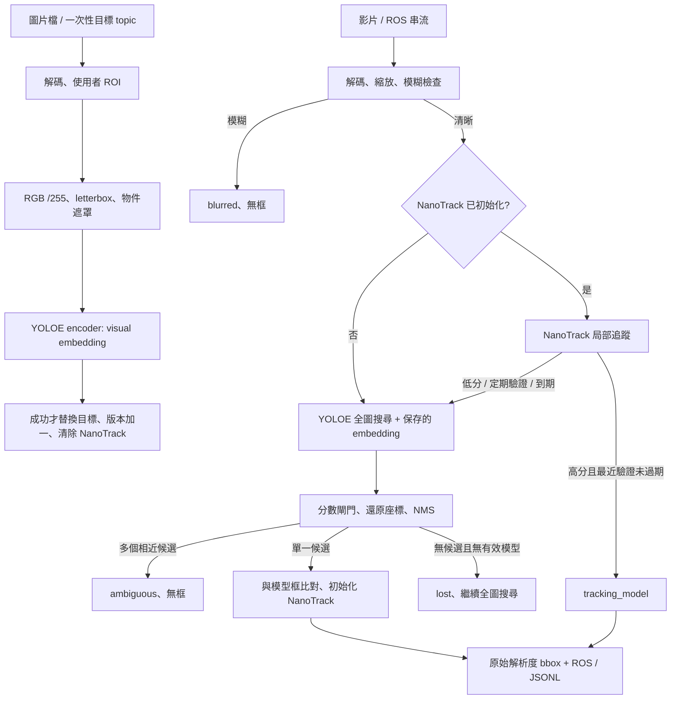

# Object Tracking — Rust / ROS 2 / YOLOE + NanoTrack

輸入連續影像與一張目標截圖，輸出單一物件的 bounding box。

**v0.3 起，全圖搜尋改為 YOLOE 視覺提示偵測，已移除 SIFT/MAGSAC 搜尋。** NanoTrack v2 保留作連續局部追蹤。目標截圖只需送一次，Rust 計算並保留 visual prompt embedding，直到新的有效截圖到達。換目標不需要重新匯出模型，不需要文字類別，也不會啟動 Python 推論服務。

執行期的影像處理、YOLOE/NanoTrack 推論、目標切換、bbox 後處理與 ROS 2 adapter 均為 Rust。Python 只用於**一次性的 YOLOE 模型匯出**，可在另一台電腦完成。機器人上只需要原生 OpenCV、ONNX Runtime 與匯出的模型。

> YOLOE 的視覺提示是外觀／類別條件，不是實體身分保證。相同外觀的多個物件仍可能混淆，從未看過的背面、遮擋、模糊也不保證能辨識。多個候選分數接近時輸出 `ambiguous`，不猜框。驗證範圍見 [docs/VALIDATION.md](docs/VALIDATION.md)。

## 1. 輸入與輸出

| 項目 | 選項／格式 | 行為 |
|---|---|---|
| 連續影像 | `--video demo.mp4` | 讀取影片，每幀處理；依 FPS 節奏讀取，運算慢時播放也較慢 |
| 連續影像 | `--video camera:0` | OpenCV 攝影機 index |
| 連續影像 | `--video rtsp://...` | 依本機 FFmpeg/GStreamer 支援的串流 |
| 連續影像 | `--image-topic /camera/image_raw` | ROS `sensor_msgs/msg/Image` |
| 連續影像 | 加 `--image-compressed` | 改為 `sensor_msgs/msg/CompressedImage` |
| 目標截圖 | `--target object.jpg` | 啟動時載入，保留 visual embedding |
| 目標截圖 | `--target-topic /tracker/target_image` | 每張有效新圖片作為換目標事件；平時不必重傳 |
| 目標截圖 | 加 `--target-compressed` | 改用 `CompressedImage` |
| ROS 結果 | `/tracker/bbox` | `mobile_tracker_interfaces/msg/TrackingResult` |
| 文字結果 | stdout／`--jsonl results.jsonl` | 一行一筆 JSON；診斷寫 stderr |

影片／ROS 串流 × 圖片／ROS 截圖四種組合皆可。連續影像來源二選一；`--target` 與 `--target-topic` 可以同時指定，先用檔案初始化再接收換目標事件。影片模式加 `--ros` 也可發布 ROS bbox。

**截圖中有背景時**，請傳緊貼物件的裁圖，或使用 `--target-roi X,Y,W,H`。ROI 位於截圖原始座標，不是串流座標；會套用到每張新截圖。程式不會自動知道截圖裡你想追哪個物件，也沒有自動前景分割。YOLOE prompt mask 排除 letterbox padding，但不能排除裁圖內的背景。

## 2. 安裝與模型準備

目標平台為 Ubuntu 22.04 / ROS 2 Humble、Ubuntu 24.04 / ROS 2 Jazzy。單純影片模式不需要 ROS。設計相容性與實際測試平台的差異見驗證紀錄。

需求：Rust stable **1.89+**、OpenCV **4.5.4+**（含 DNN）、libclang、C++ 編譯工具，以及提供 **ONNX Runtime 1.22 API 或以上**的原生共享函式庫。YOLOE 使用 CPU ONNX Runtime，NanoTrack 使用 OpenCV DNN CPU backend；不要求 CUDA。

```bash
sudo apt update
sudo apt install -y build-essential cmake pkg-config clang libclang-dev libopencv-dev curl git
# 尚未安裝 Rust 時，依 https://rustup.rs 安裝 stable toolchain
rustc --version
cargo --version
pkg-config --modversion opencv4

git clone https://github.com/noName-ll/object-tracking.git
cd object-tracking
```

### 2.1 NanoTrack 模型

```bash
bash scripts/download_models.sh
```

腳本只下載兩個 NanoTrack v2 ONNX，並做 SHA-256 校驗；它不下載／匯出 YOLOE。

| 模型 | SHA-256 |
|---|---|
| `models/nanotrack_backbone_sim.onnx` | `530bdd0cd00f19afab79a863e71ba71e3312395a5dc9151af675082bdaaa2fc4` |
| `models/nanotrack_head_sim.onnx` | `0d8c0637be849f092cc7236cae02e55c8b9455ebe37ba50601d6115db4247cd9` |

### 2.2 一次性匯出 YOLOE 視覺提示模型

必須使用本專案的兩輸入匯出方式。一般 `yolo export` 產生的固定類別模型，或 prompt-free YOLOE，不能動態接收新目標截圖。

以下可以在開發電腦執行，建議使用 Python 3.10–3.12 的獨立環境：

```bash
python3 -m venv .export-venv
source .export-venv/bin/activate
pip install torch torchvision --index-url https://download.pytorch.org/whl/cpu
pip install -r scripts/requirements-yoloe-export.txt
python scripts/export_yoloe.py --model yoloe-v8s-seg.pt --size 640 --output models/yoloe
```

匯出工具固定 `ultralytics==8.3.203`，會下載官方 checkpoint，並輸出：

- `models/yoloe/encoder.onnx`：截圖＋單一物件提示遮罩 → `[1,1,512]` visual embedding。
- `models/yoloe/detector.onnx`：串流影像＋該 embedding → `[1,N,5]` 候選，欄位為 `cx,cy,w,h,score`。
- `models/yoloe/manifest.json`：匯出尺寸、格式、版本及兩個 ONNX 的 SHA-256。

工具會實際執行 ONNX checker、PyTorch／ONNX Runtime 數值比對，以及「替換 embedding 後分數是否改變」的檢查。這兩個模型**不包含任何使用者目標截圖**；日後換圖只需執行 encoder，不需重新匯出。

模型有固定 batch=1、單一視覺類別、固定影像尺寸。`--yoloe-size` 必須與匯出的 `--size` 一致。輸出只保留 bbox／score，不輸出分割 mask。預設為 YOLOE-v8s-seg 的視覺提示模式，不支援任意 YOLO/YOLOE 檔案直接替換。

### 2.3 設定原生 ONNX Runtime

Rust 使用 `ort` 動態載入原生 Runtime，透過 `ORT_DYLIB_PATH` 指定**共享函式庫檔案**，不是資料夾。

在上面的匯出電腦，可直接使用已安裝的 CPU wheel 內的原生函式庫：

```bash
export ORT_DYLIB_PATH="$(find "$PWD/.export-venv" -type f -name 'libonnxruntime.so.*' -print -quit)"
test -f "$ORT_DYLIB_PATH"
deactivate
```

這只是使用 wheel 內的原生 `.so`，Rust 執行期不會啟動 Python。正式部署可改用 [ONNX Runtime 官方發行包](https://github.com/microsoft/onnxruntime/releases)中的原生函式庫：

```bash
# 範例：依你的實際安裝位置調整
export ORT_DYLIB_PATH=/opt/onnxruntime/lib/libonnxruntime.so.1.23.2
```

將兩個 ONNX 和 `manifest.json` 複製到機器人的 `models/yoloe/`。原生 Runtime 必須符合機器人的 CPU 架構／作業系統；不要將 x86_64 的 `.so` 複製給 ARM64。必要時將 Runtime 的相依函式庫目錄加入 `LD_LIBRARY_PATH`。新終端也要設定 `ORT_DYLIB_PATH`。

模型與 Runtime 二進位不放進 Git；Ultralytics／YOLOE 的授權與本專案 Apache-2.0 不同，見 [THIRD_PARTY.md](THIRD_PARTY.md)。

### 2.4 編譯 Rust

```bash
cargo build --release --locked
./target/release/mobile-object-tracker --help
```

### 2.5 編譯 ROS 2

先安裝 ROS 2，再 source 單一發行版，不要混用 Humble/Jazzy：

```bash
source /opt/ros/humble/setup.bash  # Jazzy 改成 /opt/ros/jazzy/setup.bash
sudo apt install -y python3-colcon-common-extensions \
  ros-${ROS_DISTRO}-rosidl-default-generators \
  ros-${ROS_DISTRO}-sensor-msgs ros-${ROS_DISTRO}-std-msgs
bash scripts/build_ros2.sh
source install/interfaces/setup.bash
```

`colcon` 是 ROS 建置工具；追蹤程式仍以 Rust 執行。腳本先建置 custom message，再 source overlay，最後 `cargo build --release --locked --features ros2`。

**從 v0.2 升級必須重新建置 custom message 和 Rust**：TrackingResult 增加 `search_score`，請讓發布端與訂閱端使用相同的新 interface。切換 ROS 發行版或 message schema 時，重新建置 interfaces、source overlay，再 `cargo clean` 並重新編譯 Rust。

每個 ROS 執行終端均需：

```bash
source /opt/ros/humble/setup.bash  # 或 jazzy
source install/interfaces/setup.bash
export ROS_DOMAIN_ID=0             # 與其他 node 保持一致
export ORT_DYLIB_PATH=/你的路徑/libonnxruntime.so.1.23.2
```

Rust 執行檔直接執行，不透過 `ros2 run`。不要用 `--all-features` 部署：`ros2-doc` 僅供無 ROS 環境的型別檢查，無法建立可執行的 ROS node。

## 3. 使用方式

### 影片 + 圖片

```bash
./target/release/mobile-object-tracker \
  --video demo.mp4 --target object.jpg \
  --target-roi 120,80,240,300 --jsonl results.jsonl
```

已經裁好的圖片可省略 `--target-roi`。程式無 GUI，不需要桌面。

### ROS 相機 + 圖片

```bash
./target/release/mobile-object-tracker \
  --image-topic /camera/color/image_raw --target cropped_object.jpg
```

### ROS 相機 + 一次性目標 topic

先啟動追蹤器：

```bash
./target/release/mobile-object-tracker \
  --image-topic /camera/color/image_raw --target-topic /tracker/target_image
```

另一個已 source ROS/overlay 的終端，只發一張截圖：

```bash
./target/release/send-target --file cropped_object.jpg
# 需要換目標時才再送一張
./target/release/send-target --file another_object.jpg
```

`send-target` 先等相容 subscriber，最多 10 秒，發送一次 BGR8 後保持 publisher 存活 2 秒。追蹤器收到後將 embedding 留在記憶體，不需要持續送截圖；尚未收到有效目標時輸出 `waiting_target`。

新圖先完成解碼、ROI、尺寸和 embedding 檢查，成功後才增加 `target_generation` 並清除舊 NanoTrack 狀態。驗證失敗保留舊 embedding／版本。每張有效新圖都視為換目標，即使圖片內容相同。新圖通過 embedding 檢查不代表一定能在串流內找到物件。

### 影片 + 一次性目標 topic

```bash
./target/release/mobile-object-tracker \
  --video demo.mp4 --target-topic /tracker/target_image
```

### 影片 + 圖片，也發布 ROS bbox

```bash
./target/release/mobile-object-tracker --video demo.mp4 --target object.jpg --ros
```

### 壓縮 topic

```bash
./target/release/mobile-object-tracker \
  --image-topic /camera/image/compressed --image-compressed \
  --target-topic /tracker/target/compressed --target-compressed
```

直接訂閱 `CompressedImage`，不是 image_transport plugin。`send-target` 只發布 raw `Image`。

### 晚加入的訂閱者

預設目標 subscriber 為 reliable + volatile；應先開追蹤器，再送一次目標圖。若要接收仍存活的 publisher 保存的上一張圖片，兩端均使用 transient local：

```bash
./target/release/mobile-object-tracker \
  --image-topic /camera/image_raw --target-topic /tracker/target_image \
  --target-durability transient-local

./target/release/send-target --file object.jpg --transient-local \
  --wait-seconds 60 --keep-alive-seconds 3600
```

Transient local 不會在 publisher 結束後永久保存圖片。程式重啟也不會保留記憶體中的目標；要再次送圖或提供檔案。

## 4. 演算法流程



### 4.1 目標 embedding

1. 目標圖轉 BGR8，依 `--target-roi` 裁出物件；無 ROI 時整張圖就是提示。
2. 使用中心 letterbox 縮放到預設 640×640，padding 值為 114。
3. RGB、NCHW float32，除以 255。不同於 NanoTrack 的 RGB 0–255。
4. 在 P3 尺度建立 `[1,1,80,80]` 二值 mask，只覆蓋圖片內容，不包含 padding；裁圖內的背景仍屬於 prompt。
5. encoder 以 `images`、`visuals` 為輸入，輸出正規化的 `[1,1,512]` embedding。檢查形狀、有限值和非零能量後才提交新目標。
6. 保留 embedding；後續每幀不重跑目標 encoder。

### 4.2 YOLOE 全局搜尋

- 初次定位、NanoTrack 低分、定期驗證、最近驗證到期時，將**整張目前畫面** letterbox 至模型輸入大小。
- detector 輸入 `images` + 保存的 `embeddings`，單一視覺類別輸出 `[1,N,5]`，不是固定 COCO 類別，也不需要文字提示。
- 解碼為 bbox，拒絕 NaN、無限值、非法 score、小於 5 像素的框；還原 letterbox 與 padding，裁切至畫面內。
- 依 `--search-score` 過濾，以 `--search-iou` 做單類 NMS，最多處理分數最高的 300 個 proposals。
- NMS 後若最高兩個不同位置候選的分數差小於 `--search-margin`，輸出 `ambiguous`；否則選最高分。
- 若 YOLOE 與有效 NanoTrack 框 IoU < 0.1，也輸出 `ambiguous` 並清除短期追蹤，避免同幀直接跳到另一個位置。
- 搜尋成功用當前畫面初始化 NanoTrack，重設最近驗證時間。沒有 SIFT 特徵數要求，亦不使用單應性。

分數差閘門只降低明顯多候選歧義，不是 ReID 或實體身分驗證。不同物件的分數差較大時仍可能選錯。

### 4.3 NanoTrack 連續追蹤

NanoTrack v2 使用模板 127×127、搜尋區 255×255；CPU OpenCV DNN。RGB float32 0–255、不除以 255。Backbone 提取特徵，head 的 `input1`/`input2` 輸出 `[1,2,16,16]` 分類與 `[1,4,16,16]` 距離回歸。

Rust 使用 softmax、尺度／長寬比懲罰與 Hann window 選候選；stride=16、penalty=0.055、window influence=0.455、尺寸更新率基數=0.37。用候選的**原始前景 softmax**做 `--model-score` 閘門，低分不寫回狀態。

每 `--verify-every` 個處理影格做 YOLOE 全圖驗證。若這次 YOLOE 沒有候選，但模型仍高分，最多允許在最近一次成功 YOLOE 驗證後 `--verification-ttl-ms` 內繼續。逾時就輸出 lost。此時間使用程序單調時鐘，不是影片媒體時間。YOLOE 有多個相近候選時，即使模型高分也暫停輸出框。

原始截圖 embedding 不會被預測框自動更新，避免參考漂移；NanoTrack 模板只由成功 YOLOE 定位重新初始化。相機背景可移動，但大幅運動仍可能令局部搜尋失敗，再由 YOLOE 搜尋全圖。

### 4.4 模糊與來源中斷

- 全畫面縮小後量測灰階 Laplacian variance；低於 `--blur-threshold` 輸出 blurred、清掉 NanoTrack，不拿舊框或運動預測充當觀測。
- 清晰後用保存的 embedding 重新全圖搜尋。低紋理畫面也可能低分，可設 `--blur-threshold 0` 停用此閘門。
- 未加入去模糊模型、Kalman 預測、里程計或相機運動補償。縮短曝光、補光和降低速度仍很重要。
- 來源尺寸改變或處理間隔超過 `--gap-timeout-ms`，清掉短期狀態再搜尋。
- ROS 相機沒有新訊息超過 `--source-timeout-ms`，發布無效心跳。若 publisher 持續發舊 stamp，仍需下游檢查時間戳。

## 5. ROS topic、編碼與 QoS

| Topic | 預設型別 | QoS |
|---|---|---|
| 連續影像，名稱由使用者指定 | `sensor_msgs/msg/Image` | best-effort、volatile、keep-last depth=1 |
| 目標截圖，名稱由使用者指定 | `sensor_msgs/msg/Image` | reliable、depth=1；volatile 或指定 transient-local |
| `/tracker/bbox`，可改 `--bbox-topic` | `mobile_tracker_interfaces/msg/TrackingResult` | reliable、volatile、depth=1 |

Raw 支援 `bgr8/rgb8/mono8/bgra8/rgba8`，正確處理 `step` 的行距 padding；不接受深度、Bayer、YUV、float 等，請上游先轉換。raw 轉換上限 256 MiB，compressed buffer 上限 64 MiB。壓縮格式由 OpenCV decoder 支援度決定，不支援 compressedDepth。

目標 publisher 應使用 reliable；best-effort publisher 與 reliable subscriber 不相容。每次 polling 取已交付佇列中的最新圖片，短時間多張目標可能只處理最後一張。影像取得、ROS spin、encoder 與追蹤依序處理，不會在推論中間平行替換目標。

截圖 header 只作外觀參考，不用來同步影像。輸出保留**串流影像**的 stamp/frame_id，目標 embedding 計算不影響此來源定義。

```bash
ros2 interface show mobile_tracker_interfaces/msg/TrackingResult
ros2 topic echo /tracker/bbox
ros2 topic info /tracker/bbox --verbose
```

## 6. 輸出欄位

bbox 一律是**原始串流解析度像素座標**，不是 YOLOE letterbox、縮小圖或截圖座標。原點左上、x 向右、y 向下，使用軸對齊矩形。

| 欄位 | 意義 |
|---|---|
| `header` | ROS 保留來源 stamp/frame_id；影片是讀取完成的 UTC 系統時間與 `--frame-id`，不是相機曝光／模擬時間 |
| `sequence` | 來源處理序號；換目標／timeout 事件可重用上一個序號 |
| `target_generation` | 成功接受目標的版本，從 1 開始，無目標為 0 |
| `status` | 見下表 |
| `found` | ROS 是否有有效 bbox；false 時四個座標為 0 |
| `x,y,width,height` | ROS float32 bbox，裁切至原始畫面範圍 |
| `image_width,image_height` | 原始來源尺寸 |
| `model_score` | NanoTrack 原始前景 softmax；沒有模型候選時為 0 |
| `search_score` | 本幀被選中 YOLOE 候選的分數，未執行／未選中為 0；衝突導致無框時可能保留供診斷 |
| `inliers,inlier_ratio` | 保留舊欄位但**固定為 0**；不再代表驗證品質 |
| `blur_variance` | 縮小全畫面的 Laplacian variance |
| `processing_ms` | 影格處理時間，不含擷取、DDS、發布和寫檔；也不含換目標 encoder 的時間 |
| `has_source_position` | ROS 是否有影片位置 |
| `source_position_ms` | backend 回報的影片媒體位置；live／ROS 無此位置 |

`model_score` 和 `search_score` 的意義不同，兩者都不是校準過的實體身分正確率。JSONL 用 `bbox:{x,y,width,height}` 或 `bbox:null` 表示有效性，不是 ROS 的展平座標／found；無媒體位置時為 null。

| status | bbox | 含義 |
|---|---|---|
| `waiting_target` | 無 | 還沒收到有效目標 |
| `target_changed` | 無 | ROS 接受新目標並清除舊追蹤 |
| `tracking_verified` | 有 | 本幀通過 YOLOE 搜尋／一致性門檻，初始化 NanoTrack；名稱沿用舊版，**不再表示幾何驗證** |
| `tracking_model` | 有 | NanoTrack 高分且最近 YOLOE 驗證未過期 |
| `lost` | 無 | 沒有可信候選或驗證到期 |
| `blurred` | 無 | 畫面低於清晰度閾值 |
| `ambiguous` | 無 | 多個相近候選，或 YOLOE 與 NanoTrack 位置衝突 |
| `invalid_frame` | 無 | ROS 解碼／處理失敗 |
| `source_timeout` | 無 | ROS 相機訊息中斷，週期性發布無效結果 |
| `source_ended` | 無 | ROS 模式下影片結束／讀取失敗，最後發布一次後退出 |

無效事件保留最近相關來源 header，不能當成新的曝光時間；從未收到影格時 header/尺寸為 0。下游務必檢查 found、status、generation 和時間戳新鮮度，不要在無效時繼續使用舊框。bbox 不代表三維距離；結合深度前要對齊來源時間與座標。

## 7. 調參與相容性

| 選項 | 預設 | 意義 |
|---|---|---|
| `--yoloe-encoder` | models/yoloe/encoder.onnx | 目標 visual encoder |
| `--yoloe-detector` | models/yoloe/detector.onnx | 接收動態 embedding 的 detector |
| `--yoloe-size` | 640 | 必須與匯出尺寸相同；64–2048 且為 32 倍數 |
| `--search-score` | 0.25 | YOLOE 候選分數下限 |
| `--search-iou` | 0.5 | YOLOE NMS IoU |
| `--search-margin` | 0.05 | 不同位置前兩名分數差小於此值 → ambiguous；0 停用此門檻 |
| `--model-score` | 0.75 | NanoTrack 分數閾值 |
| `--verify-every` | 15 | 定期全圖驗證的已處理影格間隔 |
| `--verification-ttl-ms` | 5000 | 無再次 YOLOE 驗證可繼續局部追蹤的最大牆鐘時間 |
| `--max-width` | 960 | 前處理工作圖寬度上限；YOLOE 另做固定尺寸 letterbox |
| `--blur-threshold` | 25 | 模糊閘門，0 停用 |
| `--gap-timeout-ms` | 1200 | 超過此處理間隔則重新全圖搜尋 |
| `--source-timeout-ms` | 1000 | ROS 來源中斷閾值／無效心跳間隔 |
| `--backbone/--head` | models/nanotrack_*.onnx | NanoTrack v2 模型路徑 |
| `--frame-id` | camera | 只影響影片，ROS 保留來源 header |

已移除 `--min-inliers`、`--min-ratio`，舊啟動腳本需更新。YOLOE／NanoTrack 模型路徑相對於當前工作目錄。不要只降低所有閾值以維持框存在；應測試沒有目標、相似物件、底盤移動、轉面、模糊和遮擋的影片。

## 8. 限制

- YOLOE 提示相似度沒有實體身分保證；NMS／margin 不是 ReID，候選差距大仍可能追錯。
- 本版單目標、單 prompt，沒有多視角圖庫、文字提示、prompt-free 模式、自動前景分割或三維定位。
- 背面或外觀大改時可能找到同類其他物件或找不到；沒有任意轉面／模糊保證。
- CPU YOLOE 搜尋通常比原本 SIFT 更耗算力，不承諾 FPS；請在目標硬體量測。
- RTSP／攝影機使用同步 OpenCV 擷取；backend 阻塞會延遲 ROS polling 和 Ctrl-C。未加入獨立擷取執行緒、自動重連或硬性 read deadline。
- DDS depth=1 減少排隊，但不保證每個影格／短暫目標事件都被處理。低延遲部署優先使用穩定的 ROS image topic。
- 無目標持久化；重啟後重新送圖。沒有底盤／手臂控制，也不應直接以 bbox 作安全控制依據。

## 9. 測試

```bash
cargo fmt --check
cargo test --locked --no-default-features
cargo test --locked
# 需匯出兩個 YOLOE、下載 NanoTrack，並設定 ORT_DYLIB_PATH
bash scripts/download_test_assets.sh
cargo test --locked --test hybrid -- --ignored --nocapture
# 無 ROS 時只做 Rust 型別與 lint 檢查，不驗證 DDS
cargo clippy --locked --all-targets --features ros2-doc -- -D warnings
```

真正 ROS 主機，在建置並 source interfaces、設定 Runtime 後：

```bash
export IDL_PACKAGE_FILTER='builtin_interfaces;std_msgs;sensor_msgs;geometry_msgs;unique_identifier_msgs;action_msgs;mobile_tracker_interfaces'
cargo test --locked --features ros2 --test ros_transport -- --ignored --nocapture
```

ROS smoke test 只發一次目標，驗證多幀 bbox、第二個目標的版本、header 和 source timeout。自然圖測例是推論煙霧測試，不是追蹤準確率 benchmark。完整已測／未測範圍見 [驗證紀錄](docs/VALIDATION.md)。

## 10. 原始碼與故障排查

| 路徑 | 責任 |
|---|---|
| `src/yoloe.rs` | 原生 ORT、visual encoder／detector、letterbox、遮罩、解碼、NMS、歧義 |
| `src/tracker.rs` | 目標保留、YOLOE/NanoTrack 混合狀態機 |
| `src/nano.rs` | NanoTrack OpenCV DNN、Rust 後處理 |
| `src/ros.rs` | ROS image subscriptions、bbox publisher、timeout |
| `src/contract.rs`、`src/pixels.rs` | 訊息契約、bbox 和 raw 編碼／padding |
| `src/video.rs`、`src/cli.rs` | 影片輸入、CLI 與參數驗證 |
| `src/bin/send_target.rs` | 一次性目標發布工具 |
| `scripts/export_yoloe.py` | 一次性匯出，非執行期服務 |
| `ros2/mobile_tracker_interfaces` | ROS 自訂訊息 |
| `tests/` | 原生模型、影片 CLI、可選 ROS 通訊測試 |
| `legacy/python/` | 早期原型，正式 Rust 不會呼叫 |

**找不到 Runtime？** ORT_DYLIB_PATH 應是存在的共享函式庫檔案，確認版本 ≥1.22 API、架構與相依庫。不要只填資料夾或 `.onnx` 路徑。

**模型輸入／shape 不符？** 使用本專案 exporter 的成對模型；--yoloe-size 和匯出尺寸要一致。程式會拒絕固定類別 YOLO、錯誤輸出名稱／輸入形狀。

**一直 lost？** 確認目標可見、截圖裁得合理、scale 合理、模型版本一致；觀察 search_score，調整搜尋門檻。

**一直 ambiguous？** 檢查是否有相似目標、背景主導或模型框與全圖候選衝突；降低 margin 只會減少拒絕，不會讓身分判斷變準。

**一直 blurred？** 查看 blur_variance，低紋理和縮放也會低分，調整門檻或設為 0。

**收不到目標 topic？** 檢查 ROS_DOMAIN_ID、名稱、raw/compressed 型別、reliable／durability，先啟動 subscriber 再送一次目標。

**ROS custom message 不符？** v0.3 增加 search_score，重建 interfaces、所有訂閱端及 Rust binding，再 source overlay。不要用 ros2-doc 執行。
